# 📦 REST API Daftar Produk dengan Express.js & Prisma ORM


> **Tugas Pemrograman Web — Integrasi Prisma ORM**  
> Melanjutkan project **API Daftar Produk** pada tugas sebelumnya (yang semula menggunakan array statis di memori) menjadi RESTful API yang terintegrasi penuh dengan database **SQLite** menggunakan **Prisma ORM**.

---

## 📋 Daftar Isi

1. [Deskripsi Project](#-deskripsi-project)
2. [Struktur Direktori](#-struktur-direktori)
3. [Skema Database Prisma](#-skema-database-prisma)
4. [Spesifikasi Endpoint API](#-spesifikasi-endpoint-api)
5. [Cara Menjalankan Project](#-cara-menjalankan-project)
6. [Laporan Evidence — Skenario Pengujian API (Hoppscotch)](#-laporan-evidence--skenario-pengujian-api-hoppscotch)
7. [Laporan Evidence — Perubahan Database (Before - After)](#-laporan-evidence--perubahan-database-before---after)

---

## 📖 Deskripsi Project

Project ini adalah pengembangan lanjutan dari **API Daftar Produk** menggunakan **Express.js** dan **Prisma Client**. Seluruh operasi manipulasi data kini tersimpan secara persisten pada database SQLite (`prisma/dev.db`) serta dilengkapi validasi input berlapis.

### Fitur Wajib yang Diimplementasikan:
- **`GET /products`** — Menampilkan seluruh data produk dari database.
- **`POST /products`** — Membuat data produk baru dengan validasi field wajib & tipe data.
- **`PUT /products`** — Mengupdate data produk yang sudah ada (**menggunakan body yang sama dengan `POST` ditambah properti `id`**).
- **`DELETE /products/:id`** — Menghapus data produk yang sudah ada berdasarkan `id`.
- **`GET /products/:id`** *(Fitur lanjutan dari tugas sebelumnya)* — Menampilkan detail satu produk berdasarkan `id`.

---

## 📂 Struktur Direktori

```text
TUGAS-PEMWEB-2/
├── controllers/
│   └── productController.js   # Logika bisnis CRUD & validasi input dengan Prisma Client
├── lib/
│   └── prisma.js              # Singleton instance PrismaClient
├── prisma/
│   ├── migrations/            # Riwayat migrasi tabel Product pada SQLite
│   ├── schema.prisma          # Definisi model database Prisma
│   └── seed.js                # Script seeder data produk awal
├── routes/
│   └── productRoutes.js       # Routing endpoint /products
├── screenshots/               # Bukti pengujian Hoppscotch & Prisma Studio (Before-After)
├── .env.example               # Contoh konfigurasi environment variable
├── .gitignore                 # Daftar file yang diabaikan Git
├── index.js                   # Entry point server Express.js
├── package.json               # Konfigurasi dependensi & npm scripts
└── README.md                  # Dokumentasi & Laporan Evidence GitHub
```

---

## 🗄️ Skema Database Prisma

File konfigurasi `prisma/schema.prisma`:

```prisma
generator client {
  provider = "prisma-client-js"
}

datasource db {
  provider = "sqlite"
  url      = "file:./dev.db"
}

model Product {
  id        Int      @id @default(autoincrement())
  name      String
  price     Float
  stock     Int
  createdAt DateTime @default(now())
  updatedAt DateTime @updatedAt
}
```

---

## 🔌 Spesifikasi Endpoint API

Base URL: `http://localhost:3000`

| Method | Endpoint | Deskripsi | Request Body (JSON) | Response Sukses | Response Error |
| :--- | :--- | :--- | :--- | :--- | :--- |
| `GET` | `/products` | Menampilkan seluruh data produk | — | `200 OK` | `500 Internal Server Error` |
| `GET` | `/products/:id` | Menampilkan detail produk berdasarkan `id` | — | `200 OK` | `400 Bad Request`, `404 Not Found` |
| `POST` | `/products` | Membuat data produk baru | `{ "name": string, "price": number, "stock": int }` | `201 Created` | `400 Bad Request` |
| `PUT` | `/products` | Mengupdate data produk (body sama dengan `POST` + `id`) | `{ "id": int, "name": string, "price": number, "stock": int }` | `200 OK` | `400 Bad Request`, `404 Not Found` |
| `DELETE` | `/products/:id` | Menghapus data produk berdasarkan `id` | — | `200 OK` | `400 Bad Request`, `404 Not Found` |

---

## 🚀 Cara Menjalankan Project

1. **Clone repository ini**
   ```bash
   git clone <LINK_REPOSITORY_GITHUB_ANDA>
   cd TUGAS-PEMWEB-2
   ```

2. **Install seluruh dependensi**
   ```bash
   npm install
   ```

3. **Jalankan migrasi Prisma & generate Prisma Client**
   ```bash
   npx prisma migrate dev
   npx prisma generate
   ```

4. **Isi data awal (Seeder — opsional)**
   ```bash
   npm run seed
   ```

5. **Jalankan server Express**
   ```bash
   npm start
   ```
   Server berjalan pada `http://localhost:3000`.

6. **Membuka Prisma Studio (untuk memantau isi database secara visual)**
   ```bash
   npx prisma studio
   ```
   Prisma Studio dapat diakses pada `http://localhost:5555`.

---

## 🧪 Laporan Evidence — Skenario Pengujian API (Hoppscotch)

Berikut adalah hasil pengujian berbagai skenario pada REST API menggunakan **Hoppscotch** mulai dari skenario **Success (`200`/`201`)**, **Kesalahan Validasi (`400 Bad Request`)**, hingga **Data Tidak Ditemukan (`404 Not Found`)**.

---

### 1. `GET /products` — Menampilkan Seluruh Data (Success `200 OK`)
- **Endpoint:** `GET http://localhost:3000/products`
- **Hasil:** Berhasil mengembalikan seluruh data produk awal (`Buku Tulis Campus` dan `Pulpen Pilot Hitam`) dari database SQLite beserta jumlah total data (`count: 2`).

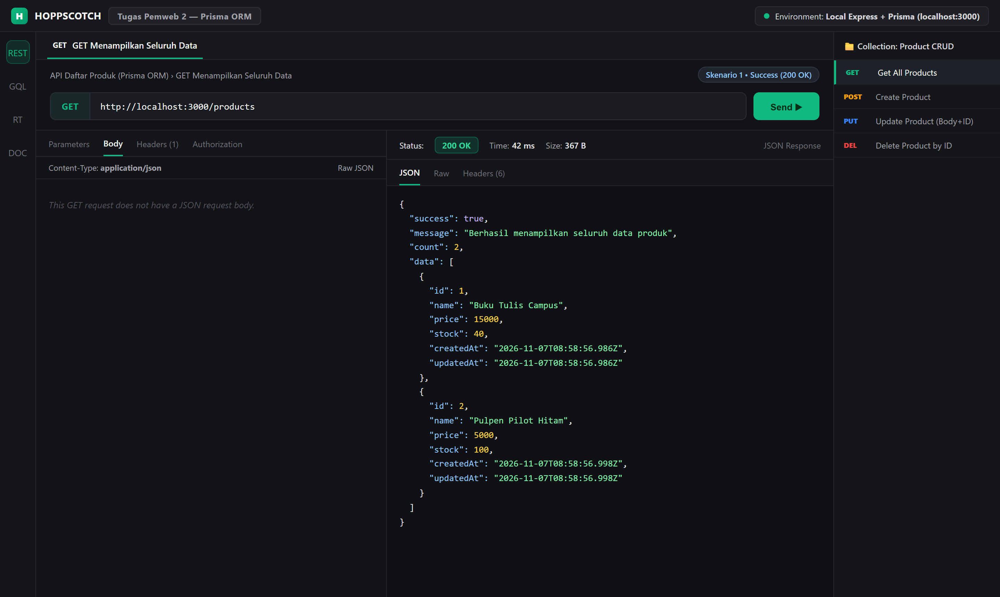

---

### 2. `POST /products` — Membuat Data Produk Baru (Success `201 Created`)
- **Endpoint:** `POST http://localhost:3000/products`
- **Request Body:**
  ```json
  {
    "name": "Kalkulator Scientific Casio",
    "price": 175000,
    "stock": 25
  }
  ```
- **Hasil:** Produk baru berhasil tersimpan ke database SQLite melalui `prisma.product.create()` dengan `id: 3` dan status `201 Created`.

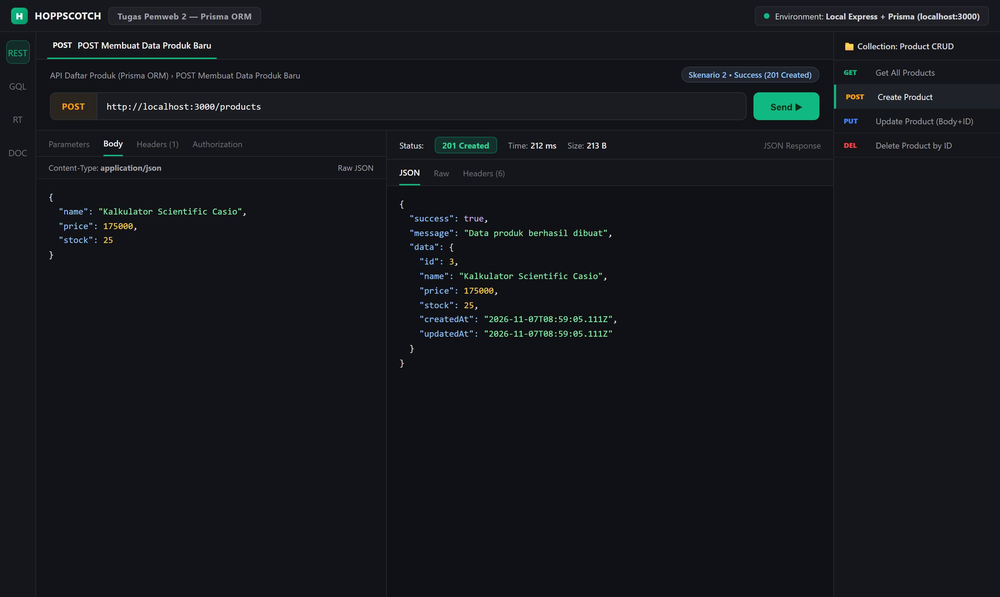

---

### 3. `POST /products` — Kesalahan Validasi: Field Wajib Tidak Lengkap (`400 Bad Request`)
- **Endpoint:** `POST http://localhost:3000/products`
- **Request Body:** `{ "name": "Penggaris Besi 30cm" }` *(tanpa menyertakan `price` dan `stock`)*
- **Hasil:** API menolak request dengan status `400 Bad Request` dan pesan `"Validasi gagal: field name, price, dan stock wajib diisi"`.

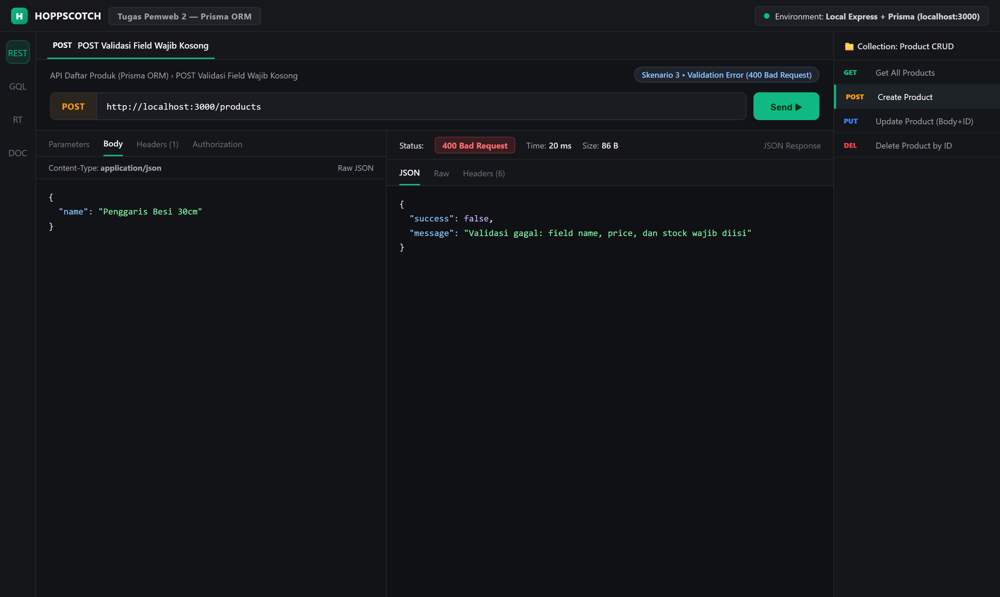

---

### 4. `POST /products` — Kesalahan Validasi: Tipe Data Tidak Sesuai (`400 Bad Request`)
- **Endpoint:** `POST http://localhost:3000/products`
- **Request Body:** `{ "name": "Spidol Snowman", "price": "delapan ribu", "stock": 15 }` *(`price` dikirim berupa string, bukan angka)*
- **Hasil:** API menolak request dengan status `400 Bad Request` dan pesan `"Validasi gagal: price harus berupa angka"`.

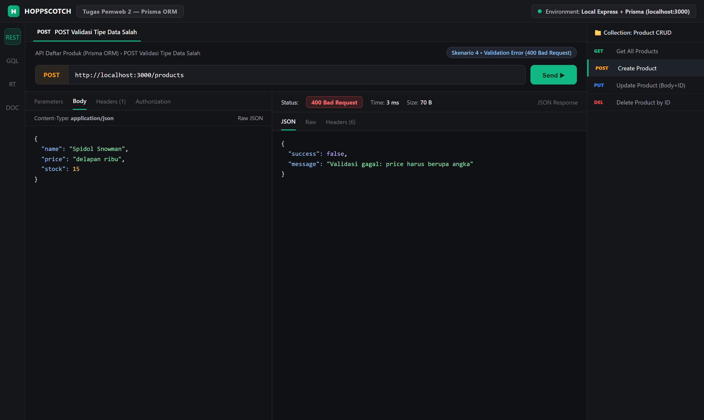

---

### 5. `PUT /products` — Mengupdate Data yang Sudah Ada (Success `200 OK`)
- **Endpoint:** `PUT http://localhost:3000/products`
- **Request Body *(sama dengan POST ditambah `id`)*:**
  ```json
  {
    "id": 1,
    "name": "Buku Tulis Campus Isi 58 Lembar",
    "price": 18500,
    "stock": 65
  }
  ```
- **Hasil:** Data produk dengan `id: 1` berhasil diperbarui pada database dan kolom `updatedAt` diperbarui otomatis oleh Prisma.

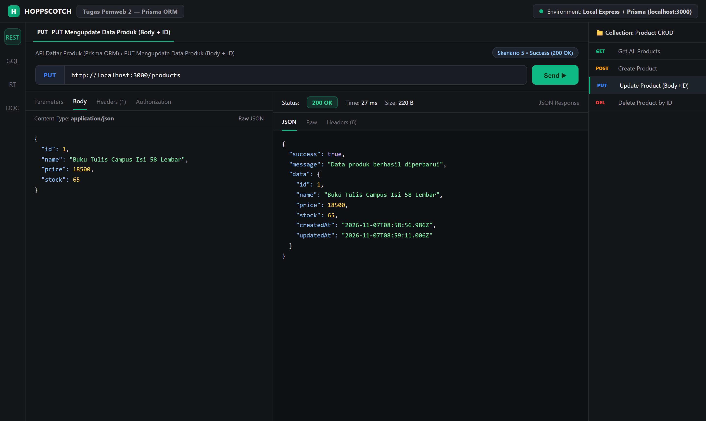

---

### 6. `PUT /products` — Kesalahan Validasi: Tanpa Menyertakan `id` pada Body (`400 Bad Request`)
- **Endpoint:** `PUT http://localhost:3000/products`
- **Request Body:** `{ "name": "Buku Gambar A3", "price": 12000, "stock": 20 }` *(tanpa `id`)*
- **Hasil:** API mengembalikan status `400 Bad Request` dengan pesan `"Validasi gagal: id wajib disertakan pada body"`.

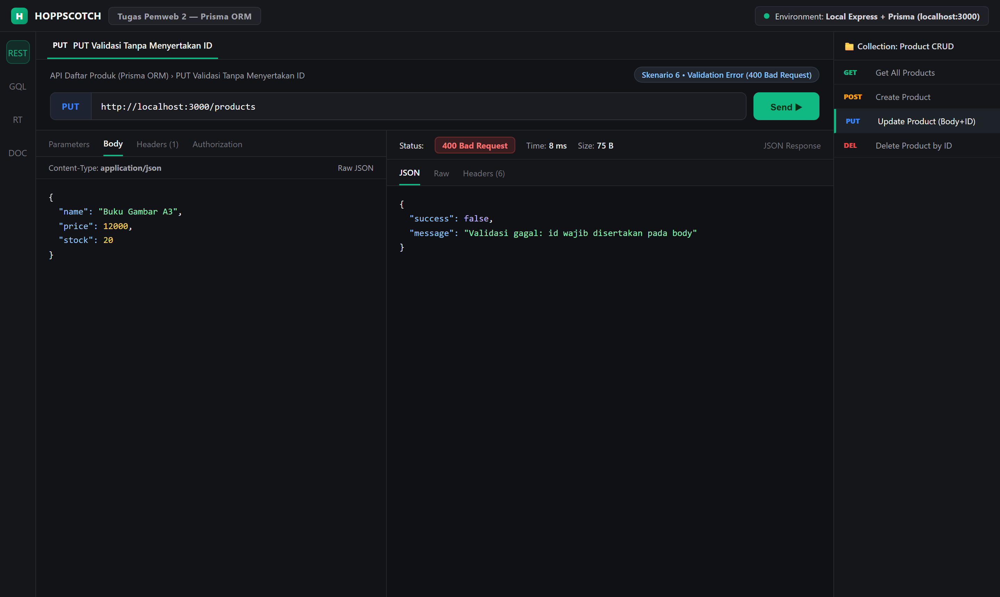

---

### 7. `PUT /products` — Error Data Tidak Ditemukan (`404 Not Found`)
- **Endpoint:** `PUT http://localhost:3000/products`
- **Request Body:** `{ "id": 999, "name": "Produk Tidak Terdaftar", "price": 10000, "stock": 5 }`
- **Hasil:** Karena produk dengan `id: 999` tidak ada di database, API mengembalikan status `404 Not Found` dengan pesan `"Data produk dengan ID 999 tidak ditemukan"`.

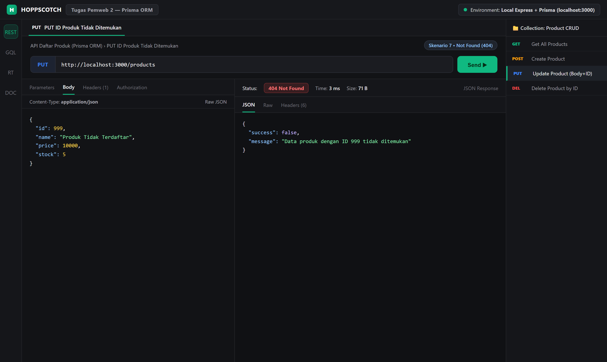

---

### 8. `DELETE /products/:id` — Menghapus Data Berdasarkan ID (Success `200 OK`)
- **Endpoint:** `DELETE http://localhost:3000/products/2`
- **Hasil:** Produk dengan `id: 2` (`Pulpen Pilot Hitam`) berhasil dihapus dari database SQLite menggunakan `prisma.product.delete()`.

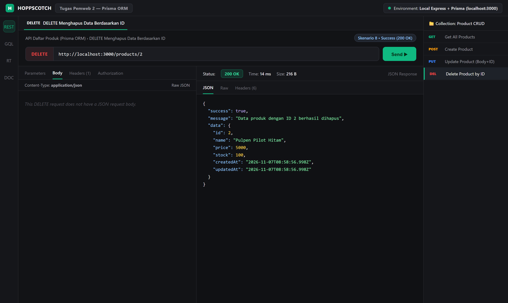

---

### 9. `DELETE /products/:id` — Error ID Tidak Ditemukan (`404 Not Found`) & ID Tidak Valid (`400 Bad Request`)
- **Skenario A (`404 Not Found`):** Menghapus kembali `DELETE /products/2` yang sudah terhapus sebelumnya menghasilkan status `404 Not Found` (`"Data produk dengan ID 2 tidak ditemukan"`).
- **Skenario B (`400 Bad Request`):** Mengirim parameter non-angka `DELETE /products/abc` menghasilkan status `400 Bad Request` (`"Validasi gagal: id harus berupa bilangan bulat positif"`).

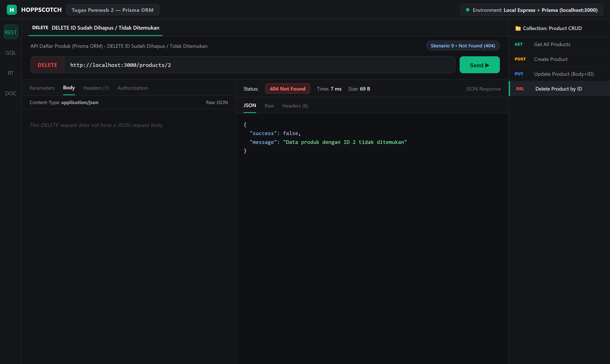

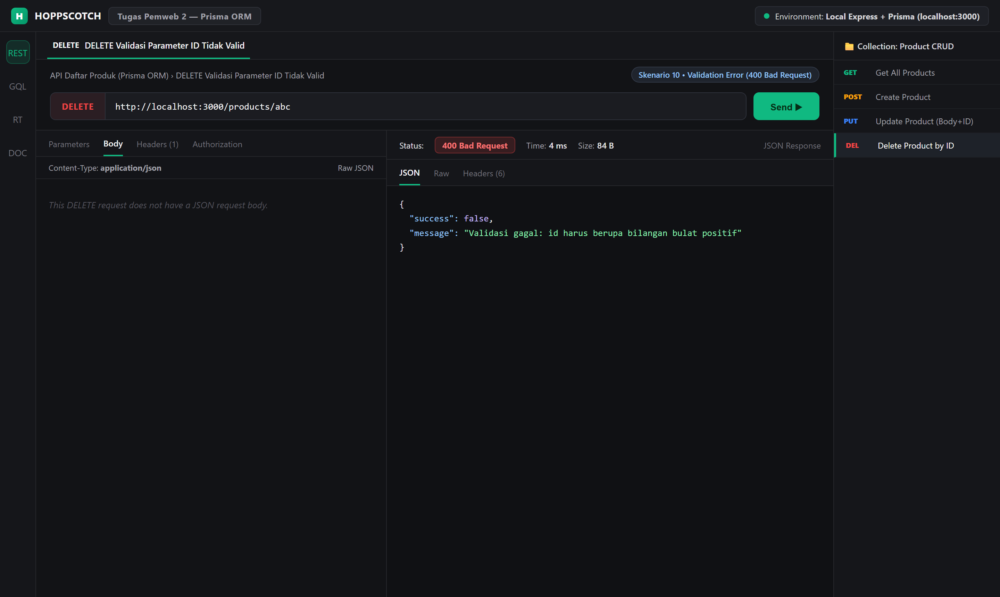

---

## 🔄 Laporan Evidence — Perubahan Database (Before - After)

Seluruh perubahan pada tabel `Product` di SQLite dipantau secara langsung melalui **Prisma Studio (`http://localhost:5555`)**.

---

### A. Perubahan Database pada Operasi `POST /products` (Menambah Data Baru)

| Kondisi | Jumlah Baris | Penjelasan Perubahan |
| :--- | :---: | :--- |
| **Before `POST`** | 2 baris | Tabel `Product` hanya berisi data awal `id: 1` (*Buku Tulis Campus*) dan `id: 2` (*Pulpen Pilot Hitam*). |
| **After `POST`** | **3 baris** | Bertambah baris baru `id: 3` (**Kalkulator Scientific Casio**, `price: 175000`, `stock: 25`). |

#### 📸 Before `POST` (Kondisi Awal Database)
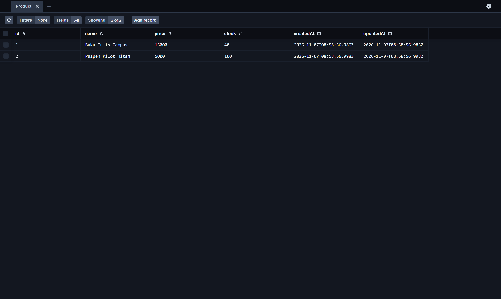

#### 📸 After `POST` (Setelah Menambahkan Produk `id: 3`)


---

### B. Perubahan Database pada Operasi `PUT /products` (Mengupdate Data `id: 1`)

| Kondisi | Data `id: 1` (`name` / `price` / `stock`) | Penjelasan Perubahan |
| :--- | :--- | :--- |
| **Before `PUT`** | `Buku Tulis Campus` / `15000` / `40` | Nilai awal sebelum dilakukan request `PUT /products`. |
| **After `PUT`** | **`Buku Tulis Campus Isi 58 Lembar` / `18500` / `65`** | Kolom `name`, `price`, `stock`, serta timestamp `updatedAt` pada baris `id: 1` berhasil ter-update. |

#### 📸 Before `PUT`


#### 📸 After `PUT` (Baris `id: 1` Berhasil Diperbarui)
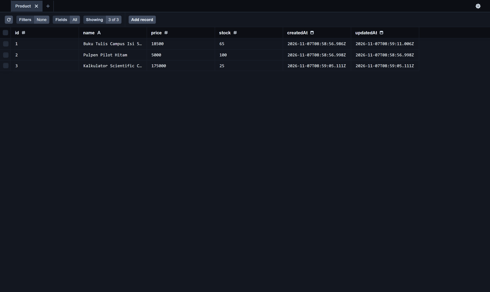

---

### C. Perubahan Database pada Operasi `DELETE /products/2` (Menghapus Data `id: 2`)

| Kondisi | Daftar ID pada Tabel `Product` | Penjelasan Perubahan |
| :--- | :---: | :--- |
| **Before `DELETE`** | `1, 2, 3` (3 baris) | Baris `id: 2` (*Pulpen Pilot Hitam*) masih tercatat di dalam database. |
| **After `DELETE`** | **`1, 3` (2 baris)** | Baris `id: 2` berhasil terhapus secara permanen dari tabel `Product` di SQLite. |

#### 📸 Before `DELETE`


#### 📸 After `DELETE` (Baris `id: 2` Telah Terhapus dari Database)
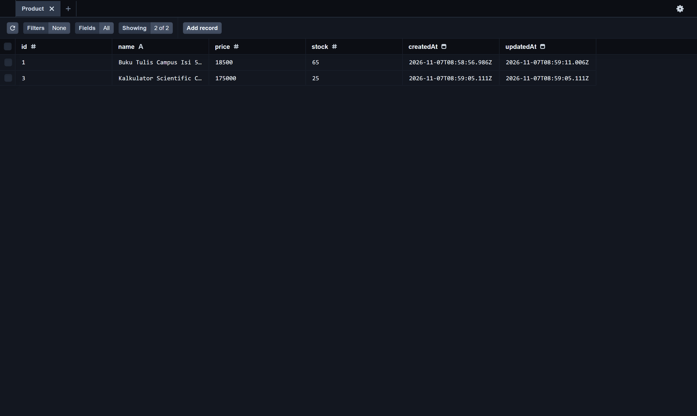

---

## ✅ Kesimpulan

Seluruh kebutuhan fungsionalitas CRUD menggunakan **Express.js + Prisma ORM + SQLite** (`GET`, `POST`, `PUT` dengan `id` pada body, dan `DELETE` berdasarkan `id`) beserta penanganan skenario validasi (`400 Bad Request`) dan data tidak ditemukan (`404 Not Found`) telah berjalan dengan baik dan terverifikasi pada database.
